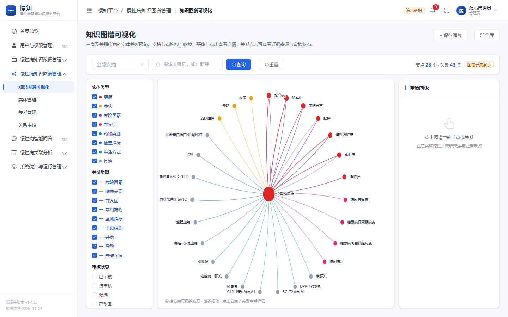
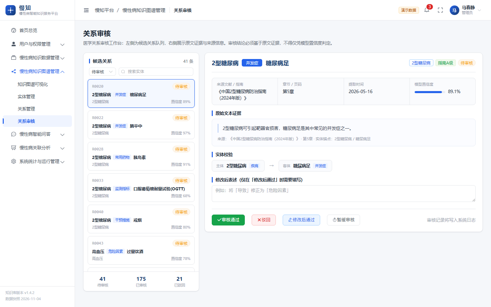
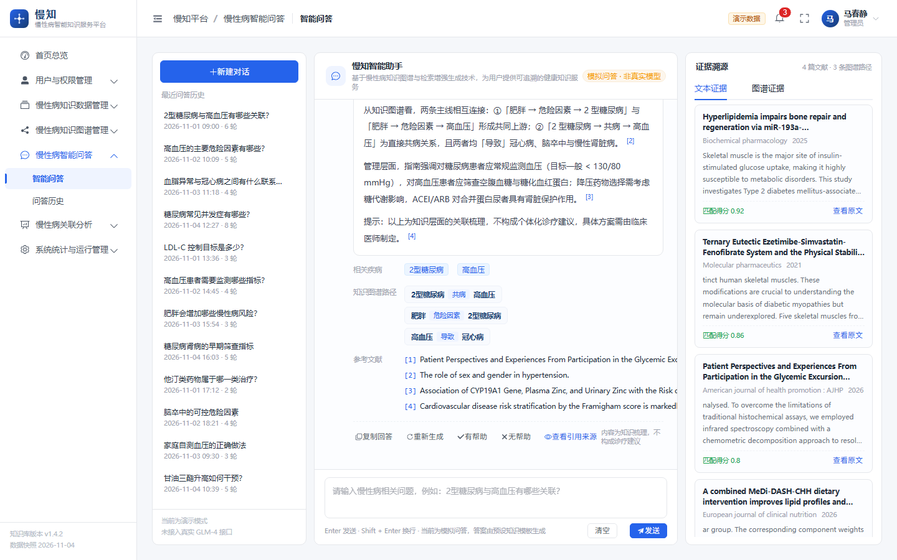
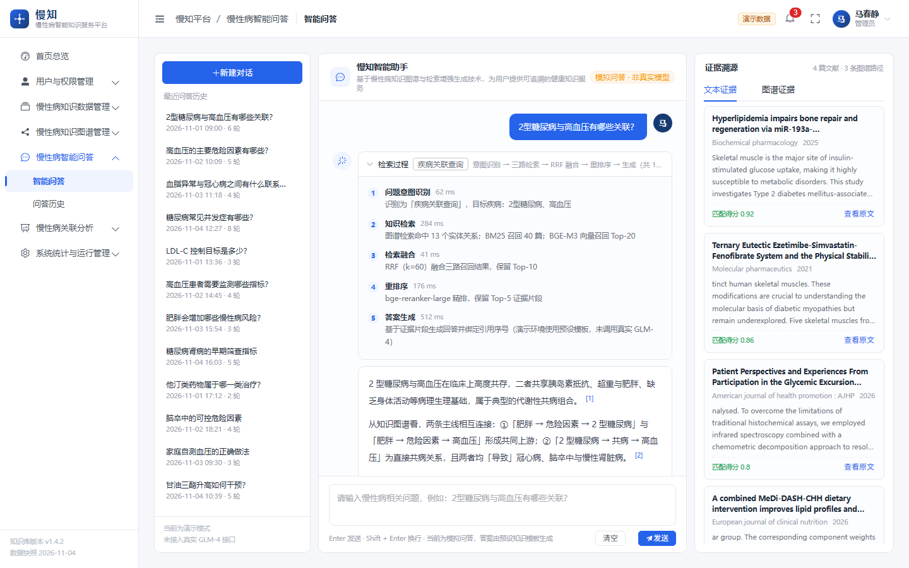
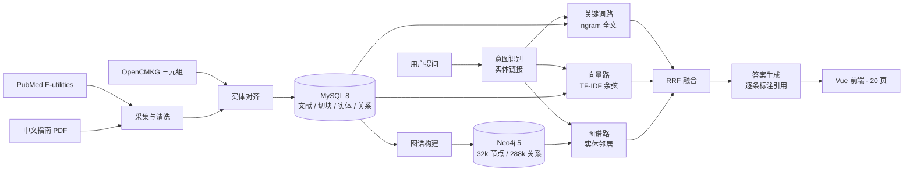

# 慢知 · 慢性病智能知识服务平台

**把 5,026 篇 PubMed 文献和 6 份中文诊疗指南，变成可溯源、可审核的慢性病知识图谱与问答系统。**

<p>
  
  
  
  
  
</p>

---

## 为什么做这个

慢性病患者和家属查资料，通常得到两种结果：搜索引擎给一堆互相矛盾的网页，大模型给一段没法验证的话。

这个项目想做第三件事 —— **每个结论都能指回原始文献的哪一段，每条图谱关系都要人工审核过才算数。**

## 界面

| 知识图谱 | 关系审核 |
|---|---|
|  |  |

| 智能问答 | 检索过程 |
|---|---|
|  |  |

## 系统能力

| 模块 | 能力 | 实现要点 |
|---|---|---|
| 数据采集 | PubMed / MedlinePlus / 中文指南 PDF | E-utilities 增量拉取，PMID 去重 |
| 知识抽取 | 文献 → 实体 → 三元组 | 规则抽取 + MeSH 词表对齐 |
| 图谱存储 | 32,091 实体 / 288,064 关系 | MySQL 8 存业务，Neo4j 5 跑图查询 |
| 关系审核 | 四态状态机 + 审计留痕 | 数据库触发器强制约束 |
| 智能问答 | 三路召回 + RRF 融合 + 引用标注 | 全文索引 + TF-IDF + 图谱邻居 |
| 关联分析 | 子图 / 最短路径 / PageRank | 递归 CTE + Cypher |
| 可视化 | 20 个页面 | Vue 3 + ECharts |

## 架构



## 三个值得讲的设计

### 1. 审核状态机放在数据库里，不放在代码里

关系有四种状态：`候选 → 待审核 → 已审核 / 已驳回`。这条规则如果只写在服务层，任何一条 SQL 都能绕过去。

所以它被写成 `BEFORE UPDATE` 触发器：

```sql
IF NOT ((OLD.`status`='候选'   AND NEW.`status`='待审核')
     OR (OLD.`status`='待审核' AND NEW.`status` IN ('已审核','已驳回'))
     OR (OLD.`status`='已驳回' AND NEW.`status`='待审核')) THEN
  SIGNAL SQLSTATE '45000'
    SET MESSAGE_TEXT='非法审核状态流转：只允许 候选→待审核→已审核/已驳回';
END IF;
```

任何路径想跳步，拿到的都是 `ERROR 1644`。合法流转则由 `AFTER UPDATE` 触发器自动往审计表写一行「谁、什么时候、从什么状态改到什么状态」。

实测效果：

```
候选 → 已审核（跳步）  ERROR 1644: 非法审核状态流转
候选 → 待审核          ✅ 成功，审计表自动 +1 行
删除被引用的实体        ERROR 1451: fk_relations_head ... ON DELETE RESTRICT
插入重复三元组          ERROR 1062: Duplicate entry for key 'uk_relations_triple'
```

### 2. 三路召回，用 RRF 而不是加权平均

关键词路（MySQL ngram 全文）、向量路（TF-IDF 余弦）、图谱路（实体一跳邻居）三路的分数不在同一个量纲上 —— 全文相关度是浮点分数，余弦相似度是 0~1，图谱邻居根本没有分数。直接加权要不停调参，而且换一批数据就失效。

改用 Reciprocal Rank Fusion：

```
score(d) = Σ_routes  1 / (60 + rank(d))
```

只用排名，不用分数，三路天然可比。实测三路确实互补：

| 路线 | 擅长 | 例子 |
|---|---|---|
| 关键词 | 术语精确匹配 | 问「他汀」命中指南原文第 92 块 |
| 向量 | 同义改写 | 问「血脂高怎么办」也能召回「血脂异常管理」 |
| 图谱 | 问题里没写但图上连着 | 问「糖尿病并发症」直接给出尿毒症、酮症酸中毒 |

### 3. 跨源实体对齐

PubMed 走 MeSH 英文词表（`Diabetes Mellitus, Type 2`），中文图谱用中文名（`糖尿病`、`中风`）。两套词汇各说各话 —— 用户问「脑卒中」，在图谱里查不到，因为 OpenCMKG 管它叫「中风」。

解法是建一张 785 条的别名表，把 MeSH 词、中文别名、OpenCMKG 实体名映射到同一个标准实体。这是多源知识融合绕不开的一步，也是这个项目里最容易被低估的工作量。

## 技术栈

| 层 | 选型 |
|---|---|
| 前端 | Vue 3.5 · Vite 6 · TypeScript · Element Plus · ECharts 5 · Pinia |
| 后端 | Flask 3 · PyMySQL · scikit-learn（TF-IDF） |
| 存储 | MySQL 8.0（业务表 + ngram 全文索引）· Neo4j 5（图查询） |
| 数据处理 | PubMed E-utilities · PyMuPDF · pandas |

## 快速开始

前置：MySQL 8.0+、Python 3.8+。Neo4j 可选，没有也能跑（图谱查询有 MySQL 递归 CTE 兜底）。

```bash
# 1. 建库：11 张表 / 2 个视图 / 2 个触发器
mysql -uroot -p < db/schema.sql

# 2. 后端
cd backend
cp ../.env.example .env          # 填入你自己的 MySQL 口令
pip install flask pymysql scikit-learn numpy
python app.py                    # http://127.0.0.1:5001

# 3. 前端（另开一个终端）
cd frontend
npm install
npm run dev                      # http://127.0.0.1:5173
```

后端首次启动会构建 TF-IDF 索引（约 14 秒，3.4 万条切块），之后走本地缓存。

**仓库不含原始语料**（版权与体积原因）。`db/samples/` 只放了 30 行格式样例，数据获取与导入方式见 [`db/README.md`](db/README.md)。

## 目录结构

```
.
├── frontend/                 Vue 3 前端 · 20 个页面
│   ├── src/views/            首页 / 数据资源 / 知识图谱 / 关系审核 / 智能问答 / 关联分析 / 系统管理
│   ├── src/api/              接口出口 —— mock 与真接口在这里切换
│   └── src/mock/             原型阶段的假数据
├── backend/                  Flask 后端 · 13 个接口
│   ├── app.py                路由层
│   ├── retrieval.py          三路召回 + RRF 融合
│   ├── nlp.py                意图识别 / 实体链接 / TF-IDF 索引
│   └── answer.py             答案组装与引用标注
├── db/                       数据层
│   ├── schema.sql            建库脚本（约束 / 索引 / 触发器 / 视图）
│   ├── queries.sql           验收查询集，含 6 条「故意报错」的约束演示
│   ├── init.cypher           Neo4j 约束、索引、全文索引
│   └── import_*.py           导入管线
└── docs/
    ├── openapi.yaml          58 个接口的 OpenAPI 3.0 契约
    ├── 接口清单.md
    └── screenshots/
```

## 数据规模

| 项 | 数量 | 来源 |
|---|---:|---|
| 文献 | 5,063 | PubMed 5,026 + MedlinePlus 31 + 中文指南 6 |
| 文本切块 | 34,309 | 300 字 / 50 重叠 + 指南按章节切分 |
| 实体 | 32,091 | OpenCMKG + MeSH 对齐 |
| 关系 | 288,064 | OpenCMKG 13 类映射为 9 类 |

## 已知限制

写清楚，避免误导：

- **向量检索用 TF-IDF，不是 BGE-M3**。本机没有 GPU，跑不动 7B 级嵌入模型。TF-IDF 足以验证「三路召回 + RRF」这条流程；生产环境应换成 BGE-M3 + Milvus，替换点集中在 `nlp.py` 的 `build()`。
- **答案由模板拼接，不是大模型生成**。图谱事实 + 文献原文 + 引用编号，可读但不够"聪明"。接入 LLM 只需重写 `answer.py` 里的 `compose()`。
- **OpenCMKG 原始数据带噪声**。1,292 个实体名长度 ≤2（如「1」「21」「8-11」），已标为候选状态，图谱默认只显示已审核节点。
- **PubMed 文献是英文，中文语料只有 6 份指南**。中文提问能召回中文指南切块，但关联英文文献只能靠语义相似度兜底。

## 关于

个人项目，持续迭代中。想解决的是「慢病资料查得到、却不知道信不信得过」这件事。

数据来源：[PubMed](https://pubmed.ncbi.nlm.nih.gov/) · [OpenCMKG](https://github.com/OpenKG-ORG/OpenCMKG) · 公开诊疗指南

## License

[MIT](LICENSE) —— 代码可自由使用。文献与指南原文版权归原作者所有，本仓库不包含原始语料。
